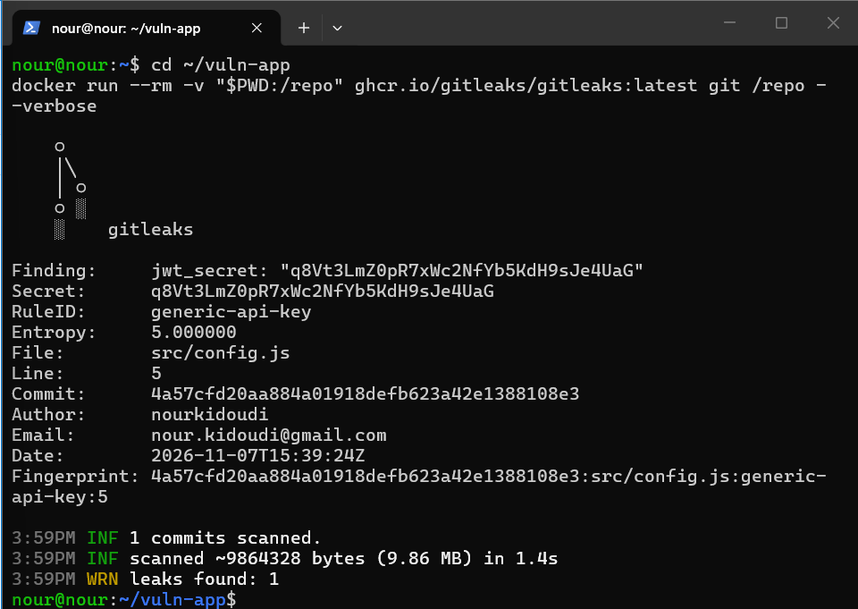
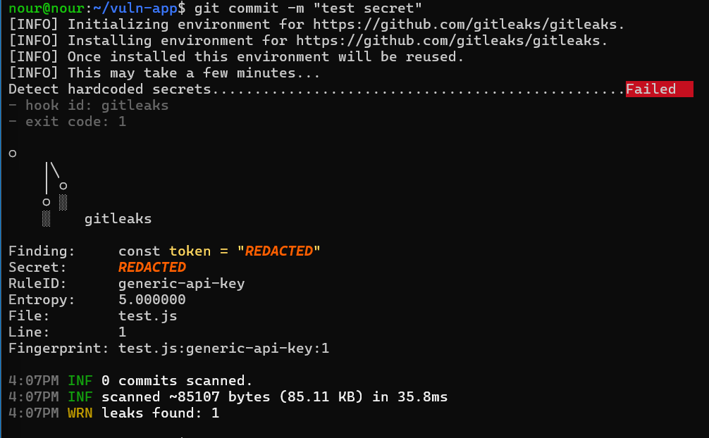
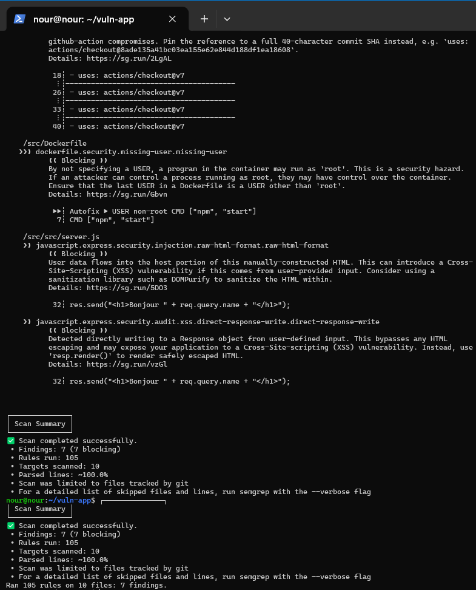
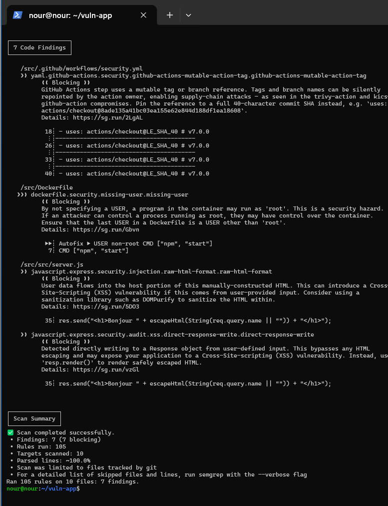
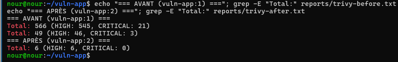
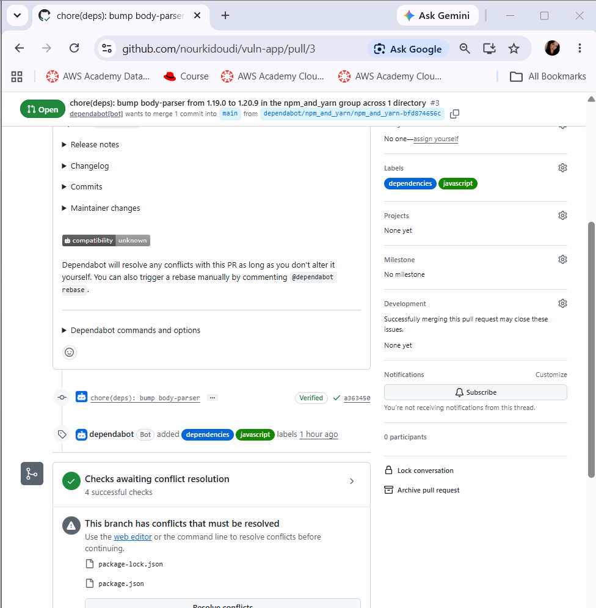
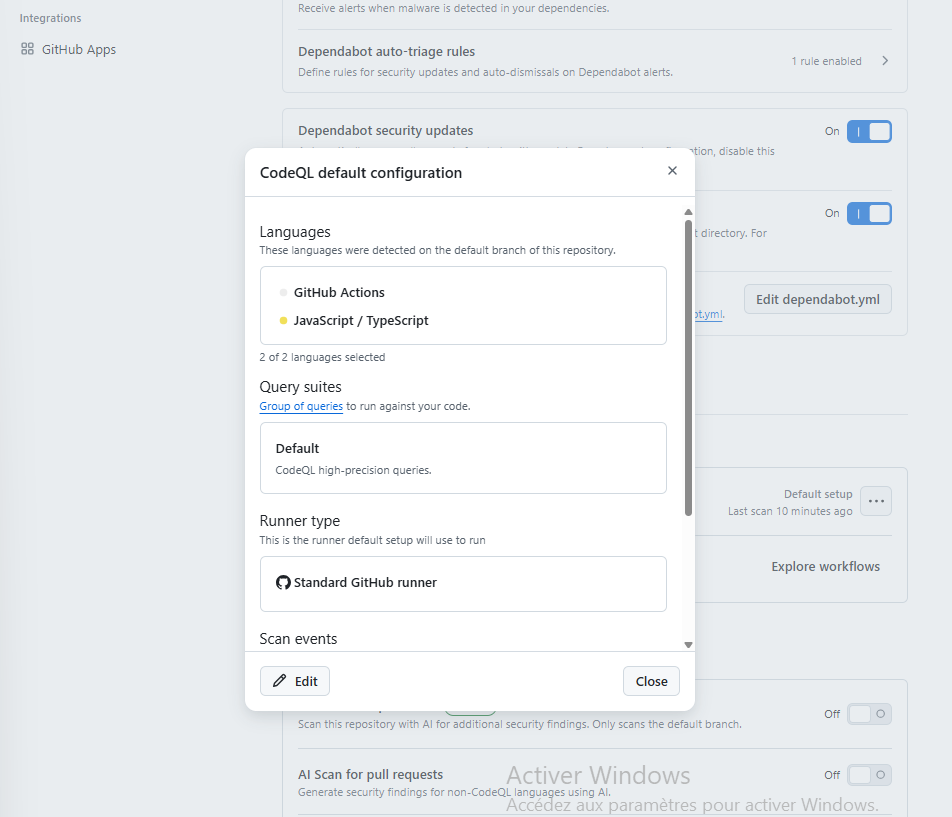
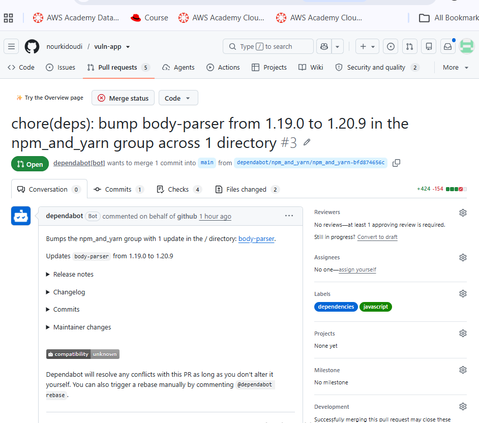
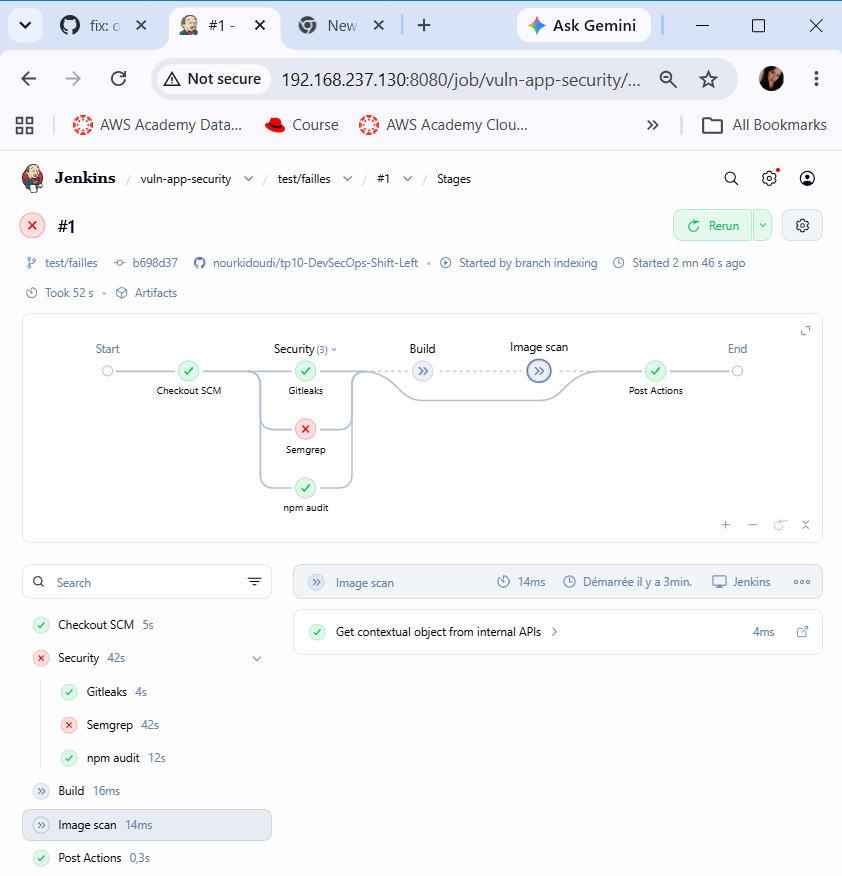
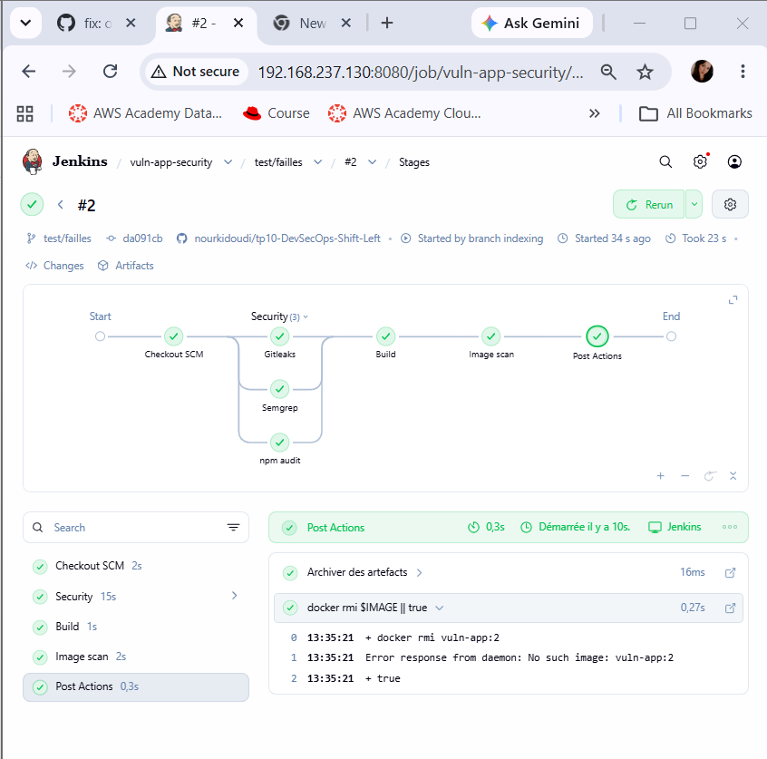

# TP10 : DevSecOps « Shift Left »

**Master DevOps & Cloud Computing, ISET Tozeur** · Étudiante : Nour Kidoudi

Analyse d'une application volontairement vulnérable (`vuln-app`) avec des outils open source (Gitleaks, Semgrep, CodeQL, npm audit, OWASP Dependency-Check, Dependabot, Trivy), intégration dans GitHub Actions et Jenkins avec des quality gates, puis correction des failles.

> L'application contient de vraies failles (injection SQL, injection de commande, XSS, dépendances vulnérables) et des secrets factices. Elle n'a été exécutée que dans la VM de lab.

## Sommaire

1. [Environnement](#1-environnement)
2. [Partie 1 : Secrets avec Gitleaks](#2-partie-1--secrets-avec-gitleaks)
3. [Partie 2 : Hook pre-commit](#3-partie-2--hook-pre-commit)
4. [Partie 3 : SAST avec Semgrep](#4-partie-3--sast-avec-semgrep)
5. [Partie 4 : Dépendances et images](#5-partie-4--dépendances-et-images)
6. [Partie 5 : GitHub (CodeQL, Dependabot, workflow, ruleset)](#6-partie-5--github)
7. [Partie 6 : Quality gates dans Jenkins](#7-partie-6--quality-gates-dans-jenkins)
8. [Problèmes rencontrés](#8-problèmes-rencontrés)
9. [Livrables](#9-livrables)

---

## 1. Environnement

- VM Ubuntu Server avec Docker, Node.js, Git, pipx.
- Tous les scanners sont lancés en conteneur (rien à installer).
- Dépôt GitHub public : `nourkidoudi/tp10-DevSecOps-Shift-Left`.
- Jenkins sur la même VM (job multibranch `vuln-app-security`).

| Famille | Question posée | Outils |
|---|---|---|
| Secrets | Un mot de passe ou un token est-il dans Git ? | Gitleaks, push protection GitHub |
| SAST | Mon code contient-il des motifs dangereux ? | Semgrep, CodeQL |
| SCA | Mes dépendances ont-elles des CVE connues ? | npm audit, OWASP Dependency-Check, Dependabot |
| Image | Les paquets de l'image ont-ils des CVE ? | Trivy image |
| Config | Le Dockerfile est-il mal configuré ? | Trivy config |

---

## 2. Partie 1 : Secrets avec Gitleaks

```bash
docker run --rm -v "$PWD:/repo" ghcr.io/gitleaks/gitleaks:latest git /repo --verbose
```

| Règle | Fichier:ligne | Commit |
|---|---|---|
| `generic-api-key` | `src/config.js:5` (`jwt_secret`) | `4a57cfd` |



**Remarque : un faux négatif.** Gitleaks n'a détecté que `jwt_secret`. `payment_api_key` et `db_password` n'ont pas été signalés, car les règles reposent sur des motifs et sur l'entropie. Un scanner de secrets ne remplace donc pas la revue de code.

**Correction.**

- Secrets déplacés dans des variables d'environnement (`process.env.JWT_SECRET`, `PAYMENT_API_KEY`, `DB_PASSWORD`).
- `.env.example` créé (noms des variables, valeurs vides), `.env` ajouté au `.gitignore`.
- `ENV DB_PASSWORD` supprimé du Dockerfile.

**Pourquoi le secret est-il toujours détecté après correction ?** Git conserve tous les anciens commits : le secret reste lisible dans l'historique (`2 commits scanned`, même détection sur le commit `4a57cfd`). Supprimer le fichier ne suffit jamais. Pour un vrai secret il faut :

1. le **révoquer** (le considérer comme compromis) ;
2. éventuellement réécrire l'historique (`git filter-repo`).

Pour le lab, l'historique a été repris à zéro (`rm -rf .git && git init -b main`) et un fichier `.gitleaksignore` vide a été créé pour documenter les futurs faux positifs.

---

## 3. Partie 2 : Hook pre-commit

```bash
pipx install pre-commit
pre-commit autoupdate && pre-commit install
```

Test avec une ligne `const token = "Zk3P9x..."` dans `test.js` : le commit est **refusé** (`Detect hardcoded secrets... Failed`, règle `generic-api-key`, `test.js:1`). Après retrait de la ligne, le commit passe (`Passed`).



---

## 4. Partie 3 : SAST avec Semgrep

```bash
docker run --rm -v "$PWD:/src" semgrep/semgrep \
  semgrep scan --config p/javascript --config p/owasp-top-ten --error /src
```

### Tableau des résultats (avant correction : 7 résultats bloquants)

| Règle | Fichier:ligne | Vrai positif ? | Correction |
|---|---|---|---|
| `raw-html-format` | `src/server.js:32` | Oui (XSS réfléchi) | Réponse JSON : `res.json({ message: ... })` |
| `direct-response-write` | `src/server.js:32` | Oui (même faille, 2 règles) | idem |
| `missing-user` | `Dockerfile:7` | Oui (conteneur en root) | `USER node` |
| `github-actions-mutable-action-tag` (×4) | `.github/workflows/security.yml:18, 26, 33, 40` | Oui (tag `v7` déplaçable) | Action épinglée par SHA de commit complet |
| `dependabot-missing-cooldown` (×2) | `.github/dependabot.yml` | Oui (bonne pratique) | `cooldown: default-days: 7` |

La dernière règle est apparue après l'ajout de `dependabot.yml` (partie 5).

### Faux négatifs de Semgrep

Avec ces deux packs de règles, Semgrep n'a **pas** signalé trois failles pourtant bien présentes dans `server.js` : l'**injection SQL** (concaténation dans la requête), l'**injection de commande** (`exec` avec une entrée utilisateur) et le **JWT sans `expiresIn`**. Elles ont été corrigées quand même :

- requête paramétrée : `db.all("... WHERE name = ?", [req.query.name], ...)` ;
- `execFile("ping", ["-c", "1", host])` avec validation du paramètre `host` par expression régulière ;
- `jwt.sign(..., { expiresIn: "1h" })` et secret lu depuis l'environnement.

### Après correction

`Findings: 0`, code retour 0.

**Avant correction (7 résultats) :**



**Après correction (0 résultat) :**



---

## 5. Partie 4 : Dépendances et images

### npm audit

| | Avant | Après |
|---|---|---|
| Vulnérabilités | **16** (5 low, 10 high, 1 critical) | **0** |
| Code retour `--audit-level=high` | 1 | 0 |

Les 16 vulnérabilités viennent de quatre familles : `express` (body-parser, qs, path-to-regexp, cookie, send, serve-static), `jsonwebtoken`, `lodash` et `sqlite3` (via `tar` et `node-gyp`).

La vulnérabilité **critical** (`tar`) provient d'un outil de compilation utilisé à l'installation de `sqlite3`, pas du code exécuté par l'API : la gravité affichée ne reflète pas le risque réel.

Corrections : `express@4.22.3`, `jsonwebtoken@9.0.3`, `lodash@4.18.1`, `sqlite3@6.0.1`.

### OWASP Dependency-Check

> **À compléter :** résultat de `reports/dependency-check-report.html` (nombre de vulnérabilités, gravité de `lodash`, `jsonwebtoken`, `express`, `sqlite3`). Si l'analyse n'a pas pu aboutir (clé API NVD refusée tant qu'elle n'était pas activée), le mentionner ici avec la capture de l'erreur.

**Comparaison avec `npm audit` :** les deux outils n'utilisent pas les mêmes sources (base d'avis GitHub pour npm audit, base NVD pour Dependency-Check). Les listes de CVE et les gravités diffèrent donc en partie.

### Trivy

| | Avant (`vuln-app:1`, `node:14`) | Après (`vuln-app:2`, `node:24-alpine`) |
|---|---|---|
| Vulnérabilités HIGH/CRITICAL, OS | 566 (545 HIGH, 21 CRITICAL) | — |
| Vulnérabilités HIGH/CRITICAL, paquets Node | 49 (46 HIGH, 3 CRITICAL) | — |
| **Total image** | **615** | **6** (6 HIGH, 0 CRITICAL) |
| Taille de l'image | 1,44 Go | — |
| Trivy config (Dockerfile) | 2 échecs : `DS-0002` (HIGH, pas de `USER`), `DS-0026` (LOW, pas de `HEALTHCHECK`) | 0 échec HIGH/CRITICAL |



### Nouveau Dockerfile

- image `node:24-alpine`, build **multi-stage** (seul le résultat est copié dans l'image finale) ;
- `USER node` (plus de root) ;
- `HEALTHCHECK` ajouté ;
- plus aucun secret dans `ENV` ;
- `.dockerignore` (`node_modules`, `.git`, `.env`, `reports`).

Les 6 HIGH restants appartiennent à l'image de base ; ils sont masqués dans la CI par `--ignore-unfixed` quand aucun correctif n'existe.

---

## 6. Partie 5 : GitHub

### Dependabot

`.github/dependabot.yml` : écosystèmes `npm` et `github-actions`, fréquence hebdomadaire, `cooldown` de 7 jours (ajouté après une alerte Semgrep). Dependabot a ouvert plusieurs Pull Requests (mises à jour d'`express` et de dépendances groupées).



### CodeQL et comparaison avec Semgrep



| Faille | Semgrep | CodeQL |
|---|---|---|
| Injection SQL | Non détectée | *(à compléter)* |
| Injection de commande | Non détectée | *(à compléter)* |
| XSS | Détecté (`raw-html-format`, `direct-response-write`) | *(à compléter)* |

Les deux outils sont complémentaires : un seul ne suffit pas.

### Workflow `security.yml`

- `permissions: contents: read` au niveau du workflow ; `security-events: write` uniquement pour le job `sast` (envoi du SARIF) ;
- jobs : `secrets` (Gitleaks, historique complet), `sast` (Semgrep avec export SARIF), `dependencies` (`npm ci` puis `npm audit --audit-level=high`), `image` (build, Trivy image `--severity CRITICAL --exit-code 1 --ignore-unfixed`, Trivy config) ; `image` dépend des trois autres (`needs`) ;
- chaque Action tierce est **épinglée par SHA de commit complet** : `actions/checkout@3d3c42e…` (`# v7.0.1`) et `github/codeql-action/upload-sarif@33d7b85…` (`# v4.39.3`).

**Pourquoi épingler par SHA ?** Un tag (`v4`) peut être déplacé vers un code malveillant si le dépôt de l'Action est compromis. Un SHA de commit est immuable. Dependabot (`github-actions`) propose ensuite les mises à jour.

### Ruleset sur `main`

Règle `protect-main` : Pull Request obligatoire, 1 approbation, checks `secrets`, `sast`, `dependencies` et `image` obligatoires, push direct et suppression interdits. Le push direct sur `main` est refusé par GitHub (`GH013: Repository rule violations`). Le propriétaire du dépôt est en liste de contournement *pour les Pull Requests uniquement* (une seule personne ne peut pas approuver sa propre PR).

### PR qui réintroduit les failles

La branche `test/failles` réintroduit l'injection SQL et le XSS. La PR est **bloquée** : le check `sast` est rouge et le merge est refusé.



---

## 7. Partie 6 : Quality gates dans Jenkins

Le `Jenkinsfile` ajoute :

1. un stage **Security** exécutant **en parallèle** Gitleaks, Semgrep et npm audit ;
2. un stage **Build** (`docker build`) ;
3. un stage **Image scan** (Trivy, `--severity CRITICAL --exit-code 1 --ignore-unfixed`) ;
4. `archiveArtifacts 'reports/**'` pour conserver les rapports, et `docker rmi` pour libérer le disque.

Chaque scan écrit son rapport dans `reports/` et fait échouer le stage s'il trouve un problème.

Job Jenkins : `vuln-app-security` (Multibranch Pipeline, toutes les branches).

| Branche | Résultat | Explication |
|---|---|---|
| `test/failles` (failles réintroduites) | **Rouge** | le stage Semgrep échoue (XSS), Build et Image scan sont sautés |
| `main` / `test/failles` après correction | **Vert** | les 3 scans, le build et le scan d'image passent |

**Pipeline rouge (failles réintroduites) :**



**Pipeline vert (failles corrigées) :**



---

## 8. Problèmes rencontrés

| Problème | Cause | Solution |
|---|---|---|
| Gitleaks : `0 commits scanned` | commande lancée hors du dossier du dépôt | `cd ~/vuln-app` avant le scan |
| `no space left on device` (Trivy) | disque de la VM plein à 99 % (images et cache Docker) | `docker builder prune`, `docker image prune -a` (sans toucher au volume `dc-data`) |
| Dependency-Check : `Invalid API Key` | la clé NVD n'était pas activée (HTTP 404) | activation par le lien reçu par email, test `curl` (HTTP 200) |
| Trivy : `connection reset by peer` | coupure réseau pendant le téléchargement de la base | cache persistant `-v trivy-cache:/root/.cache/trivy` et relance |
| Push refusé (`workflow` scope) | le token ne pouvait pas modifier `.github/workflows/` | nouveau token classic avec les scopes `repo` et `workflow` |
| Push direct refusé sur `main` | ruleset actif | branche + Pull Request |
| Build Jenkins : `gyp ERR! find Python` | `sqlite3` n'a pas pu télécharger son binaire précompilé et `node-gyp` n'a ni Python ni compilateur dans Alpine | `RUN apk add --no-cache python3 make g++` dans le stage de **build** uniquement |

---

## 9. Livrables

| Fichier | Contenu |
|---|---|
| `captures/gitleaks.png` | Secrets détectés par Gitleaks |
| `captures/pre-commit-blocked.png` | Commit refusé par le hook |
| `captures/semgrep-before.png` | Résultats Semgrep avant correction |
| `captures/semgrep-after.png` | Résultats Semgrep après correction |
| `captures/trivy-before-after.png` | Vulnérabilités de l'image avant / après |
| `captures/dependabot-pr.png` | Pull Request ouverte par Dependabot |
| `captures/codeql-alerts.png` | Alertes CodeQL |
| `captures/pr-blocked.png` | PR bloquée par un check obligatoire |
| `captures/jenkins-security-rouge.png` | Pipeline Jenkins rouge (failles réintroduites) |
| `captures/jenkins-security-vert.png` | Pipeline Jenkins vert (failles corrigées) |

Code corrigé : `src/`, `Dockerfile`, `.dockerignore`, `.gitignore`, `.env.example` · Pipelines : `.github/workflows/security.yml`, `Jenkinsfile` · Configuration : `.github/dependabot.yml`, `.pre-commit-config.yaml`, `.gitleaksignore`.
